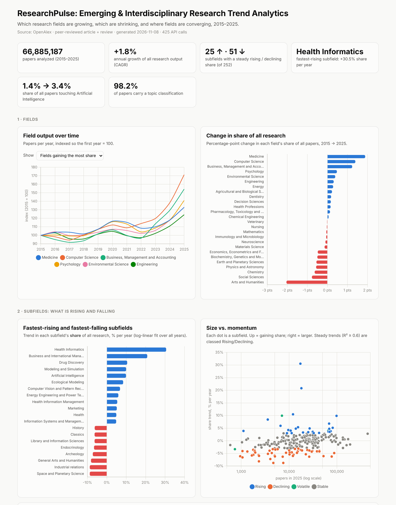

# ResearchPulse: A Bibliometric Trend-Analytics Pipeline for Detecting Emerging and Interdisciplinary Research Fields

An end-to-end analytics pipeline (**OpenAlex REST API → SQLite → SQL window-function KPIs → log-linear trend models → interactive dashboard**) that measures which of 252 research subfields are gaining or losing ground, how fast, how steadily, and where fields are converging.

**[View the live dashboard →](https://aryaingale10-stack.github.io/researchpulse/)**

## Key findings (OpenAlex, peer-reviewed articles & reviews, 2015–2025)

| Finding | Value |
|---|---|
| Papers analyzed | **66.9M** across 26 fields and 252 subfields |
| Subfields classified | **25 rising**, 51 declining, 166 stable, 3 volatile (7 too small to rank) |
| Fastest-rising subfield | **Health Informatics**: +30.5% share per year (952 → 17,263 papers), driven by the topic *AI in Healthcare and Education* (3.3K → 26.9K papers, 2019–20 vs 2024–25) |
| Artificial Intelligence | +9.9% share per year (R² 0.98); papers touching AI went from **1.4% → 3.4%** of all research |
| Where AI is spreading | Share of AI papers that also touch Medicine rose from **6.0% → 14.7%** |
| Biggest field shifts | Computer Science 3.3% → 4.7% of all research; Arts & Humanities 9.3% → 7.2% |
| Data quality | 1.8% of papers unclassified; subfield and field totals reconcile exactly |



---

## Key questions

1. Which fields and subfields are growing **faster than research overall**, and which are losing share?
2. Is each trend **steady** or just noise? Which subfields are **accelerating**?
3. Which specific research **topics** are driving the fastest-rising subfields?
4. How **interdisciplinary** is research becoming, and where is AI spreading?
5. Which **countries** lead the rising subfields, and how is a given **institution's** research mix changing?

## Architecture

```
OpenAlex API ──► collect.py ──► SQLite (raw tables) ──► sql/*.sql views ──► metrics.py ──► analysis.py ──► docs/index.html
 (group_by        cached,         subfields,             share per year,      log-linear      Tableau CSVs     (GitHub Pages)
  aggregates)     rate-limited    field_year, ...        YoY, CAGR, overlap   trend fits
```

| Stage | What it does | Key technique |
|---|---|---|
| **Collect** (`src/collect.py`, `src/openalex.py`) | ~425 aggregate API calls instead of downloading millions of records | `group_by` aggregation, on-disk response cache, rate limiting, exponential backoff, daily-budget handling |
| **Model** (`sql/`) | Raw counts → per-year share, YoY change, 5-year CAGRs, share CAGR, cross-field overlap | SQL views, `LAG`, `FIRST_VALUE`, named `WINDOW`, conditional aggregation |
| **Trend fit** (`src/metrics.py`) | Fits `log(share) ~ year` per subfield; growth % per year + R² | Log-linear OLS (NumPy), rule-based trend classification |
| **Drill-down** | Topics and country participation for the top-N rising subfields | Two-stage collection: only spend API calls where it matters |
| **Validate** (`sql/05_data_quality.sql`) | Unclassified works, zero years, subfield-vs-field reconciliation | Cross-aggregation consistency check |
| **Present** (`src/dashboard.py`, `output/tableau/`) | Interactive dashboard + tidy CSVs | Chart.js, accessible palette, light/dark mode |

## Methodology

**Share, not raw counts.** Total research output grows every year (and database coverage improves), so raw growth makes almost every field look like it's rising. Every trend here uses a subfield's **share of all papers that year**:

```
share(s, y) = works(s, y) / works(all, y)
```

**Trend = log-linear regression over all years.** A CAGR uses only two endpoints, so one unusual year can swing it. Fitting

```
ln share(s, y) = a + b·y      →   share trend = (e^b − 1) × 100  % per year
```

uses all 11 years. **R²** says how steady the trend is.

**Trend classes**

| Class | Rule |
|---|---|
| Rising | share trend > +3%/yr and R² ≥ 0.6 |
| Declining | share trend < −3%/yr and R² ≥ 0.6 |
| Stable | \|share trend\| ≤ 3%/yr |
| Volatile | \|share trend\| > 3%/yr but R² < 0.6 |
| Too small | < 500 papers in the mid-year (excluded from rankings) |

**Acceleration** = CAGR (2020→2025) − CAGR (2015→2020).
**Field overlap** = of the papers whose *primary* topic is in field X, the % that also carry a topic in field Y (OpenAlex assigns up to 3 topics per paper).

## Run it

Needs Python 3.9+ and an internet connection. Takes about 2–3 minutes and fits inside OpenAlex's free daily allowance **without an API key**.

```bash
python3 -m venv .venv
source .venv/bin/activate          # Windows: .venv\Scripts\activate
pip install -r requirements.txt
python run_all.py
```

Open `docs/index.html` in a browser.

| Option | Default | Meaning |
|---|---|---|
| `--focus-subfield` | `1702` (Artificial Intelligence) | Subfield tracked across all other fields |
| `--institution` | `University of North Texas` | Institution to profile (`""` to skip) |
| `--top-n` | `12` | Rising subfields to drill into (topics, countries) |

Optional: a free OpenAlex API key (openalex.org) raises the daily budget 10×. Set it with `export OPENALEX_API_KEY=...`.
All responses are cached in `data/openalex_cache.db`, so re-runs cost no API calls.

## Outputs

| Path | Contents |
|---|---|
| `docs/index.html` | Interactive dashboard (served by GitHub Pages) |
| `output/results.json` | Every number in the dashboard |
| `output/tableau/*.csv` | Tidy tables for Tableau / Power BI (subfield × year, metrics, overlaps, countries, topics) |
| `data/researchpulse.db` | SQLite database with raw tables and the SQL views |

## Project structure

```
run_all.py              pipeline entry point
src/openalex.py         API client: cache, rate limit, retries, budget
src/collect.py          data collection (two stages)
src/metrics.py          SQL views + log-linear trend fits + classification
src/analysis.py         dashboard data + Tableau exports
src/dashboard.py        HTML dashboard generator
sql/                    KPI views and data-quality checks
tests/mock_openalex.py  offline mock API for testing (synthetic data)
```

Test without internet:

```bash
python tests/mock_openalex.py 8766 &
OPENALEX_BASE=http://127.0.0.1:8766 python run_all.py     # synthetic numbers only
```

## Limitations

- **Peer-reviewed only.** Articles and reviews are counted; preprints are excluded to avoid double counting. Fields that publish heavily on arXiv (parts of AI, physics) are undercounted.
- **Machine-assigned topics.** OpenAlex classifies papers with a model, and some papers are mislabeled or unclassified. The unclassified share is reported on the dashboard.
- **Indexing lag.** The most recent year can still grow slightly as late records arrive; the current (partial) year is excluded.
- **Country shares overlap.** A paper counts once for every country among its authors, so shares can sum to more than 100%.
- **Counts, not impact.** The pipeline measures publication volume, not citations or quality.

## Data

[OpenAlex](https://openalex.org), an open catalog of the world's research (CC0 license).

*Inspired by research on innovation detection and interdisciplinary topic evolution at the IDEA Lab, University of North Texas. This is an independent project with its own data, methods and code.*
